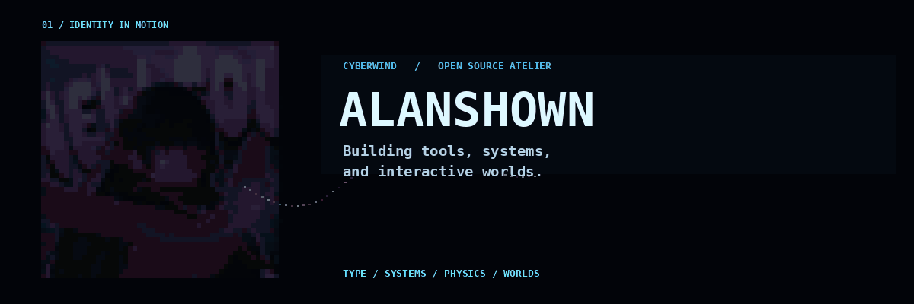
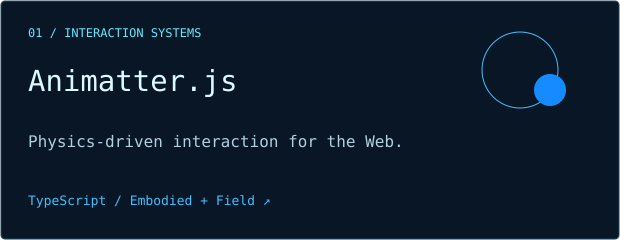
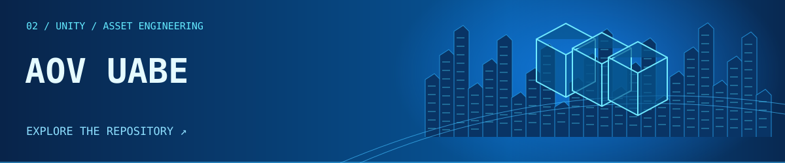
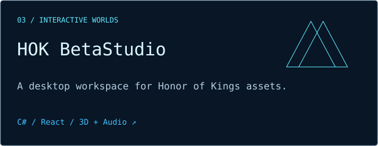

Independent Developer · Open Source Builder · Creative Engineer

## 02 / Selected work

A TypeScript interaction runtime connecting embodied agents and 2.5D physical fields through shared semantics, space and orchestration.

UnityPy-based desktop inspection, preview, import and export for Arena of Valor AssetBundles.

C# + React workspace for HOK packages, model/audio previews and batch export.

## 03 / Engineering focus

**WEB & INTERACTION**  
Web Engineering · TypeScript / JavaScript · Interaction Systems · Creative Coding

**TOOLS & WORLDS**  
Developer Tooling · Agent Workflows · Game Asset Engineering · Interactive 3D

## 04 / Current exploration

- **Physics-driven interfaces** — shared meaning, motion and behavior in [Animatter.js](https://github.com/Alanshown/Animatter.js).
- **Intelligent developer tooling** — exploring agent workflows and reusable engineering tools.
- **Game assets & 3D** — inspection, conversion and dependency-aware workflows across AOV and HOK.

## 05 / Developer activity

[Public contributions](https://github.com/Alanshown?tab=overview) · [Repositories & recent updates](https://github.com/Alanshown?tab=repositories)

Activity stays on GitHub: no external statistics service, invented counts or tracking images.

---

**BUILD · EXPLORE · ITERATE**  
*Design is behavior. Code is the medium.*

[Alanshown](https://github.com/Alanshown) · [Static banner](assets/banner.svg) · [Visual system & reproduction](docs/DESIGN.md)
